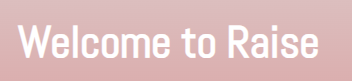
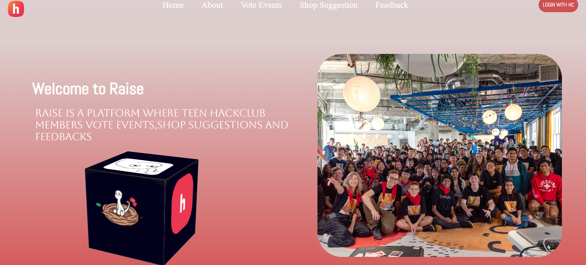
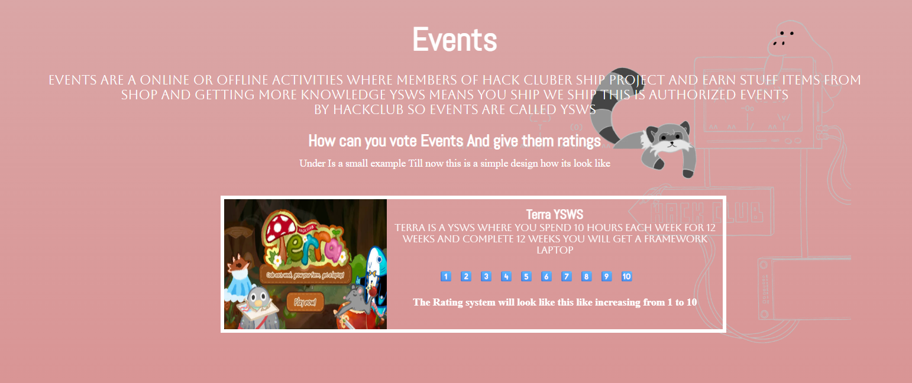
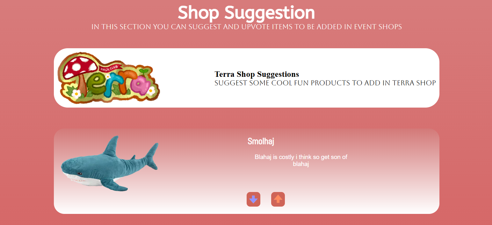
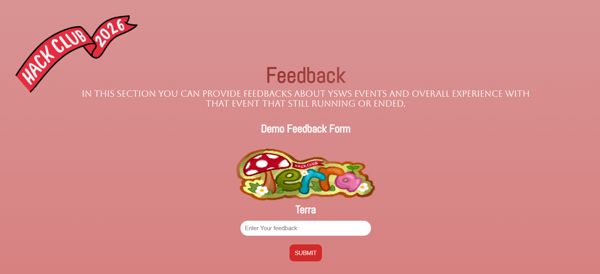

# Welcome to Raise



This website is for hackclub where teens can vote event running and ended and also can see deatils and feedbacks.It also come with shop suggestions also.

This is the overview of the website:



# Features

Their are now 3 pages in thsi website:

1. **Event VotePage**: This page is for voting the events running and ended and also can see deatils and feedbacks.



2. **Shop Suggestion Page**: This page is for suggesting the shop items.



3. **Feedback Page**: This page is for giving feedbacks about the events.



4. **A responsive website**: This website is responsive and can be used on any device.

5. **Design is cool**: the design many is from the hackclub website and also the design is cool and attractive.

# Tech Stack

1. HTML

2. CSS

3. JavaScript

# How to run website

1. Clone the repository

```bash

git clone https://github.com/JazilJafar/Raise.git

```

2. Open the index.html file in your browser

**Another**: You can view the website online by clicking [here](https://raise-seven-iota.vercel.app/)

# Contributing

**You can contribute to this project because this is an open source project.**

# License

MIT License

Copyright (c) 2026 Jazil Jafar V V

Permission is hereby granted, free of charge, to any person obtaining a copy
of this software and associated documentation files (the "Software"), to deal
in the Software without restriction, including without limitation the rights
to use, copy, modify, merge, publish, distribute, sublicense, and/or sell
copies of the Software, and to permit persons to whom the Software is
furnished to do so, subject to the following conditions:

The above copyright notice and this permission notice shall be included in all
copies or substantial portions of the Software.

THE SOFTWARE IS PROVIDED "AS IS", WITHOUT WARRANTY OF ANY KIND, EXPRESS OR
IMPLIED, INCLUDING BUT NOT LIMITED TO THE WARRANTIES OF MERCHANTABILITY,
FITNESS FOR A PARTICULAR PURPOSE AND NONINFRINGEMENT. IN NO EVENT SHALL THE
AUTHORS OR COPYRIGHT HOLDERS BE LIABLE FOR ANY CLAIM, DAMAGES OR OTHER
LIABILITY, WHETHER IN AN ACTION OF CONTRACT, TORT OR OTHERWISE, ARISING FROM,
OUT OF OR IN CONNECTION WITH THE SOFTWARE OR THE USE OR OTHER DEALINGS IN THE
SOFTWARE.

# Thank You

**Thank you for visiting our website. i hope you liked it thank you feel free to give feedbacka and contribute**